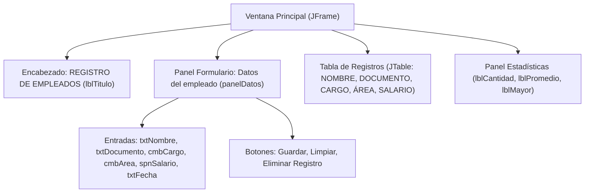

# Documentación Técnica: Sistema de Registro de Empleados (Java Swing)

## 1. Descripción General del Proyecto

El **Sistema de Registro de Empleados** es una aplicación de escritorio desarrollada en **Java Swing** utilizando el diseñador visual de **NetBeans IDE**. Permite registrar empleados, validar la integridad de la información ingresada, listar los registros en una tabla interactiva (`JTable`) y calcular estadísticas salariales en tiempo real.

### Archivos del Proyecto
- [Empleados.java](file:///c:/Users/jorda/OneDrive/Documentos/NetBeansProjects/empleados/src/main/java/com/mycompany/empleados/Empleados.java): Clase principal que inicia la aplicación invocando el formulario.
- [NewJFrame.java](file:///c:/Users/jorda/OneDrive/Documentos/NetBeansProjects/empleados/src/main/java/com/mycompany/empleados/NewJFrame.java) / [RegistroEmpleados.java](file:///c:/Users/jorda/OneDrive/Documentos/NetBeansProjects/empleados/src/main/java/com/mycompany/empleados/RegistroEmpleados.java): Clases `JFrame` que contienen la interfaz gráfica y toda la lógica de negocio.
- [NewJFrame.form](file:///c:/Users/jorda/OneDrive/Documentos/NetBeansProjects/empleados/src/main/java/com/mycompany/empleados/NewJFrame.form) / [RegistroEmpleados.form](file:///c:/Users/jorda/OneDrive/Documentos/NetBeansProjects/empleados/src/main/java/com/mycompany/empleados/RegistroEmpleados.form): Archivos XML de diseño visual de NetBeans GUI Builder.

---

## 2. Diseño del Formulario y Componentes



| Campo Visual | Variable en Código | Componente Java Swing | Configuración / Opciones |
| :--- | :--- | :--- | :--- |
| **Título** | `lblTitulo` | `JLabel` | Texto `"REGISTRO DE EMPLEADOS"`, centrado, fondo con color personalizado. |
| **Nombre Completo** | `txtNombre` | `JTextField` | Campo de texto libre para el nombre del empleado. |
| **Documento** | `txtDocumento` | `JTextField` | Campo de texto para el documento de identidad. |
| **Cargo** | `cmbCargo` | `JComboBox<String>` | Opciones: `Auxiliar`, `Analista`, `Supervisor`, `Coordinador`. |
| **Área** | `cmbArea` | `JComboBox<String>` | Opciones: `Recursos Humanos`, `Sistemas`, `Contabilidad`, `Producción`. |
| **Salario** | `spnSalario` | `JSpinner` | Modelo numérico (`SpinnerNumberModel`) con paso de `50,000` y formato `#,##0.##`. |
| **Fecha de Ingreso** | `txtFecha` | `JFormattedTextField` | Campo de texto para ingresar la fecha en formato `dd/mm/aaaa`. |
| **Botón Guardar** | `btnGuardar` | `JButton` | Valida los datos, agrega el empleado a la tabla y actualiza estadísticas. |
| **Botón Limpiar** | `btnLimpiar` | `JButton` | Restablece todos los controles del formulario a su estado inicial. |
| **Botón Eliminar** | `btnEliminar` | `JButton` | Elimina la fila seleccionada de la tabla y recalcula estadísticas. |
| **Tabla** | `tabla` | `JTable` | Columnas no editables: `NOMBRE`, `DOCUMENTO`, `CARGO`, `ÁREA`, `SALARIO`. |

---

## 3. Explicación Detallada del Código

### 3.1. Inicialización y Formato de la Tabla (`configurarComponentes`)

En el constructor de [`NewJFrame`](file:///c:/Users/jorda/OneDrive/Documentos/NetBeansProjects/empleados/src/main/java/com/mycompany/empleados/NewJFrame.java#L40-L62), después de llamar a `initComponents()`, se ejecuta `configurarComponentes()`:

```java
private void configurarComponentes() {
    txtFecha.setFormatterFactory(null);
    spnSalario.setModel(new javax.swing.SpinnerNumberModel(0.0d, null, null, 50000.0d));
    spnSalario.setEditor(new JSpinner.NumberEditor(spnSalario, "#,##0.##"));
    tabla.setSelectionMode(ListSelectionModel.SINGLE_SELECTION);
    tabla.getColumnModel().getColumn(COL_SALARIO).setCellRenderer(new javax.swing.table.DefaultTableCellRenderer() {
        @Override
        protected void setValue(Object value) {
            setHorizontalAlignment(javax.swing.SwingConstants.RIGHT);
            if (value instanceof Number) {
                setText("$" + FORMATO_MONEDA.format(((Number) value).doubleValue()));
            } else {
                super.setValue(value);
            }
        }
    });
}
```
- **Propósito**: Configura el editor numérico del `JSpinner`, obliga a que en la tabla solo se pueda seleccionar una fila a la vez (`SINGLE_SELECTION`) y aplica un renderizador visual en la columna `SALARIO` para mostrar los valores con formato de moneda (`\$2.500.000`).

---

### 3.2. Botón Guardar y Validaciones (`btnGuardarActionPerformed`)

Ubicado en [`btnGuardarActionPerformed`](file:///c:/Users/jorda/OneDrive/Documentos/NetBeansProjects/empleados/src/main/java/com/mycompany/empleados/NewJFrame.java#L329-L378), implementa los requerimientos de **Nivel Básico** y **Nivel Intermedio**:

```java
private void btnGuardarActionPerformed(java.awt.event.ActionEvent evt) {
    String nombre = txtNombre.getText().trim();
    String documento = txtDocumento.getText().trim();
    String cargo = (String) cmbCargo.getSelectedItem();
    String area = (String) cmbArea.getSelectedItem();
    String fecha = txtFecha.getText().replace("_", "").trim();

    // 1. Nivel Intermedio: Validar que ningún campo esté vacío
    if (nombre.isEmpty() || documento.isEmpty() || cargo == null || area == null
            || fecha.isEmpty() || fecha.equals("//")) {
        mostrarError("Falta información: por favor complete todos los campos.");
        return;
    }

    // 2. Capturar el salario del JSpinner
    double salario;
    try {
        spnSalario.commitEdit();
        salario = ((Number) spnSalario.getValue()).doubleValue();
    } catch (java.text.ParseException ex) {
        try {
            String textoSalario = ((JSpinner.DefaultEditor) spnSalario.getEditor())
                    .getTextField().getText().trim().replace(".", "").replace(",", ".");
            salario = Double.parseDouble(textoSalario);
        } catch (NumberFormatException e) {
            mostrarError("Ingrese un valor numérico válido para el salario.");
            spnSalario.requestFocus();
            return;
        }
    }

    // 3. Nivel Intermedio: Validar que el salario sea mayor a 0
    if (salario <= 0) {
        mostrarError("El salario debe ser mayor a 0.");
        spnSalario.requestFocus();
        return;
    }

    // 4. Nivel Básico: Agregar fila a la JTable
    DefaultTableModel modelo = (DefaultTableModel) tabla.getModel();
    modelo.addRow(new Object[]{nombre, documento, cargo, area, salario});

    // 5. Nivel Avanzado y Limpieza
    actualizarEstadisticas();
    limpiar();
}
```

---

### 3.3. Botón Limpiar (`limpiar`)

Ubicado en [`limpiar`](file:///c:/Users/jorda/OneDrive/Documentos/NetBeansProjects/empleados/src/main/java/com/mycompany/empleados/NewJFrame.java#L399-L409):

```java
private void limpiar() {
    txtNombre.setText("");
    txtDocumento.setText("");
    cmbCargo.setSelectedIndex(0);
    cmbArea.setSelectedIndex(0);
    spnSalario.setValue(0.0);
    txtFecha.setValue(null);
    txtFecha.setText("");
    tabla.clearSelection();
    txtNombre.requestFocus();
}
```
- **Propósito**: Borra el texto de `txtNombre`, `txtDocumento` y `txtFecha`, regresa los `JComboBox` a su primera opción (`índice 0`), reinicia `spnSalario` en `0.0`, deselecciona la tabla y coloca el cursor en `txtNombre`.

---

### 3.4. Botón Eliminar Registro (`btnEliminarActionPerformed`)

Ubicado en [`btnEliminarActionPerformed`](file:///c:/Users/jorda/OneDrive/Documentos/NetBeansProjects/empleados/src/main/java/com/mycompany/empleados/NewJFrame.java#L384-L397):

```java
private void btnEliminarActionPerformed(java.awt.event.ActionEvent evt) {
    int fila = tabla.getSelectedRow();
    if (fila < 0) {
        JOptionPane.showMessageDialog(this, "Seleccione una fila de la tabla para eliminar.",
                "Aviso", JOptionPane.INFORMATION_MESSAGE);
        return;
    }
    int r = JOptionPane.showConfirmDialog(this, "¿Eliminar el registro seleccionado?",
            "Confirmar", JOptionPane.YES_NO_OPTION);
    if (r == JOptionPane.YES_OPTION) {
        DefaultTableModel modelo = (DefaultTableModel) tabla.getModel();
        modelo.removeRow(tabla.convertRowIndexToModel(fila));
        actualizarEstadisticas();
    }
}
```
- **Propósito**: Verifica que exista una fila seleccionada (`fila >= 0`), solicita confirmación al usuario, elimina la fila del modelo de datos (`removeRow`) y recalcula las estadísticas.

---

## 4. Explicación de las Estadísticas (Nivel Avanzado)

El método [`actualizarEstadisticas`](file:///c:/Users/jorda/OneDrive/Documentos/NetBeansProjects/empleados/src/main/java/com/mycompany/empleados/NewJFrame.java#L411-L433) calcula los tres indicadores solicitados en el **Nivel Avanzado**:

```java
private void actualizarEstadisticas() {
    DefaultTableModel modelo = (DefaultTableModel) tabla.getModel();
    int n = modelo.getRowCount();
    lblCantidad.setText("Cantidad de empleados registrados: " + n);
    if (n == 0) {
        lblPromedio.setText("Promedio salarial: -");
        lblMayor.setText("Empleado con mayor salario: -");
        return;
    }
    double suma = 0;
    double max = -1;
    String nombreMax = "";
    for (int i = 0; i < n; i++) {
        double s = ((Number) modelo.getValueAt(i, COL_SALARIO)).doubleValue();
        suma += s;
        if (s > max) {
            max = s;
            nombreMax = (String) modelo.getValueAt(i, 0);
        }
    }
    lblPromedio.setText("Promedio salarial: $" + FORMATO_MONEDA.format(suma / n));
    lblMayor.setText("Empleado con mayor salario: " + nombreMax + " ($" + FORMATO_MONEDA.format(max) + ")");
}
```

### Fórmulas y Lógica Aplicada:
1. **Cantidad de empleados registrados (`n`)**:
   - Se obtiene mediante `modelo.getRowCount()`, que cuenta cuántas filas activas tiene la tabla.
   - Si `n == 0` (tabla vacía), asigna `"-"` al promedio y al salario mayor para evitar dividir entre cero.
2. **Promedio salarial**:
   - Recorre todas las filas con un ciclo `for` desde `i = 0` hasta `n - 1`.
   - Extrae el salario de cada fila en la columna `4` (`COL_SALARIO`) y lo suma en el acumulador `suma`.
   - Aplica la fórmula:
     $$\text{Promedio} = \frac{\sum_{i=0}^{n-1} \text{Salario}_i}{n}$$
3. **Empleado con mayor salario**:
   - Utiliza una variable auxiliar `max` inicializada en `-1` y `nombreMax` vacía.
   - En cada iteración del ciclo `for`, compara si el salario actual `s` supera a `max` (`s > max`).
   - Cuando se cumple la condición, actualiza `max = s` y almacena el nombre de la columna `0` (`modelo.getValueAt(i, 0)`).
   - Al finalizar el recorrido, muestra tanto el nombre del empleado como su salario formateado.
